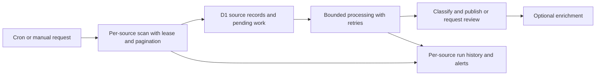

# Ingestion robustness review — October 13, 2026

## Recommendation

Prioritize complete collection, recoverable processing, and visible source failures. Keep the existing severity policy and Cloudflare/D1 stack while making ingestion resumable. Increasing polling frequency or adding more feeds before these repairs would increase work without resolving dropped records.

The review includes the production diagnosis in `incident-ingestion-audit-oct13-findings.md`, five diagnostic reproductions in `test/ingestion.test.ts`, and current Cloudflare references. Proposed implementation work is separate from this investigation; no application code, deployment, or production data was changed.

## Verified risks and proposed repairs

| Priority | Evidence | Consequence | Proposed repair |
| --- | --- | --- | --- |
| P0 | GHSA ingestion stopped May 7; production returns 401 | Largest source contributes no new incidents | Restore valid source authentication; make public-endpoint fallback bounded and visible; alert on rejected credentials |
| P0 | NVD reads six oldest results per keyword without pagination; GHSA reads only forty newest | Delayed discovery and missing pages | Persist per-source/page progress, paginate within request budgets, resume incomplete windows, and support explicit backfill |
| P0 | `src/ingestion.ts:1694` advances the proposed cursor before the event write; test reproduces a failed write never being retried | A transient database failure permanently loses an incident | Advance a durable checkpoint only after the record is saved and required processing work is recoverable; preserve gaps or retry work |
| P0 | `src/ingestion.ts:657` drops every record at or before the cursor; test reproduces a shared timestamp split by a run budget | The second record is skipped forever | Use inclusive overlap and stable record IDs, or a composite timestamp/ID checkpoint; test multi-page timestamp ties |
| P0 | Event and draft writes are separate; test reproduces a failed draft write leaving an event unpublished | Stored high-severity records can become orphaned | Persist pending publication work; retry it independently of source fetching and deduplication; add reconciliation |
| P1 | Follow-up cron at `2026-10-13T14:00:50.156Z` reports four NVD 429 errors and GHSA 401, while `phase` remains completed | Operators see apparent success despite broken sources | Track run result as healthy/degraded/failed, retain per-source history, distinguish rate limits from authentication and schema errors |
| P1 | Source order is fixed; all share a 20-second cron budget; fetch timeout is cleared before body reading (`src/ingestion.ts:540`) | A slow response body or early source can delay later sources | Give sources separate bounded deadlines and fair scheduling; cover headers, body reading, and decoding with limits; honor Retry-After |
| P1 | Manual ingestion bypasses the cron lock; lock errors proceed as if acquired; release deletes the key without checking ownership | Concurrent runs can race cursor writes or remove another run's lease | Share per-source leases across cron/manual/backfill, verify ownership on release, and refuse unsafe checkpoint changes when the lease is unavailable |
| P1 | NVD/EUVD omit authoritative severity; EUVD date field mismatches; stored summaries are capped | High-severity records may be misclassified and source changes cannot be fully reassessed | Validate versioned connector schemas; preserve raw source metadata; normalize dates/CVSS and record rejection reasons |
| P1 | Public incident query has `LIMIT 200` (`src/app.ts:410`); production contains 175 published incidents | A successful backfill can make older published pages disappear from archive lookups | Query paginated archive results in D1 and load detail pages by slug independently of the archive limit |

P0 means repair before relying on continuous coverage or running a broad backfill. P1 means include in the first hardening releases. The reproduced loss paths are code-level defects; the audit does not establish that any particular production record was lost through those paths.

## A small, durable ingestion design

Use D1 as the first durable work store. This keeps the current stack and makes the failure boundaries explicit:

Collection saves source observations before expensive interpretation. Processing updates records by a stable `(source, external_id)` key, with a separate canonical incident key such as CVE when available. A changed title should update its source observation rather than conflict with a unique source ID or create an unrelated fingerprint. Cross-source reports attach evidence to the same incident while preserving each source's provenance and severity.

Store enough progress to resume a bounded date window: source/query, window start/end, page offset/token, completed-through position, and any pending retry. A source-wide maximum timestamp alone is insufficient when four keyword queries return incomplete and differently ordered subsets. Overlap completed windows to catch source updates and ties, and rely on idempotent record writes to handle repeats.

Persist jobs with incident/source ID, operation, status, attempt count, next eligible attempt, last error, and lease ownership. Publish jobs should upsert a draft and confirm that it exists before marking work complete. Duplicate detection should avoid repeating publication, while still repairing missing publication work and attaching newer evidence. A reconciliation scan should find eligible records without drafts, pending work without completion, and stale leases.

Sequence durable writes and checkpoint acknowledgment so a crash can be replayed safely. If using a database transaction or batch for this boundary, verify its rollback behavior with real D1 integration tests; do not assume separate `.run()` calls are atomic. [D1 batch reference](https://developers.cloudflare.com/d1/worker-api/d1-database/#batch)

Cloudflare Queues is an option when independent processors or backlog justify it. Preserve the D1 pending-work/outbox record even when introducing a queue, so a failed queue send cannot strand a record. Queue consumers still need idempotent writes because delivery can repeat. This staged approach follows Cloudflare's recommendation to isolate retryable work without requiring a larger architecture immediately. [Workers guidance](https://developers.cloudflare.com/workers/best-practices/workers-best-practices/), [Queue delivery guarantees](https://developers.cloudflare.com/queues/reference/delivery-guarantees/)

## Source resilience and publication quality

Different errors need different responses:

- **401/403:** record rejected authentication and surface it immediately. Retry once without credentials only for a public source when the status and provider policy support that fallback. Do not loop on a rejected secret.
- **429:** respect Retry-After or provider reset headers, save a per-source cooldown, and resume later. Bound concurrency and total calls across cron, manual runs, and backfill.
- **Timeout/5xx:** use bounded retries with increasing delay and jitter; leave work pending after the run budget expires.
- **Schema changes:** reject or quarantine a sample with a visible reason, retain the source input, and keep other connectors running. A TypeScript assertion on upstream JSON does not validate the response.

Keep full source material or selected authoritative metadata separately from short display summaries, under explicit size and retention limits. Classify using source CVSS/severity, affected product/version, and vulnerability class. Treat relevance and severity as separate decisions; record the policy version and the reason an incident stayed in review. Avoid permanently discarding evidence because a short excerpt lacks an AI keyword.

Rename the displayed source date to “Advisory published” or “Disclosed,” and retain separate first-seen, source-updated, and Radar-publication dates. Backfilled advisories should display their historical disclosure date and actual current Radar publication date. Keep LLM rewriting optional and retryable, with a deadline and factual fallbacks; `src/llm.ts` currently has no request deadline, and auto-publishing does not invoke the manual enrichment path despite the README description.

## Make failures visible

`/health` currently returns `{ok:true}` without checking ingestion. Keep a basic liveness endpoint, but add a protected operational health endpoint and admin view showing enabled source, last successful fetch, HTTP/schema result, scan checkpoint, upstream update age, backlog, retries, and discovery lag.

A quiet source is healthy when scans succeed and no relevant items exist. Do not alert merely because no incident was published or the last matching incident date is old. Alert when successful polling stops, credentials fail, backlog cannot drain, pending publication remains unresolved, or upstream items advance while checkpoints do not.

The admin run button currently renders “Done” with counters and does not display `result.errors` or budget stops. Show source errors and partial progress in that result. Keep distinct latest-attempt and latest-success timestamps and retain bounded run history; one `run:latest:cron` row cannot explain a multi-month outage. Add structured warning/error logs and explicitly configure observability; the checked-in Wrangler file has no observability section. [Cloudflare logging guidance](https://developers.cloudflare.com/workers/best-practices/workers-best-practices/#enable-workers-logs-and-traces)

Suggested initial targets, subject to the provider polling limits: expose an authentication error on its first failed run; alert on a missing hourly heartbeat after two intervals; discover ordinary current API advisories within two polling intervals; and tolerate a failed write/repeated delivery without permanent loss or duplicate publication. Measure these rather than treating a green cron result as proof of coverage.

## Proposed implementation sequence

1. **Restore collection and safe progress.** Repair GitHub auth and NVD/GHSA pagination together with overlap/tie handling and safe checkpoint advancement. Tests must prove that all pages and shared-timestamp records eventually appear and a failed write remains retryable.
2. **Make processing recoverable.** Add D1 pending publication work, owned per-source leases for every trigger, bounded retries/cooldowns, and reconciliation. Failure tests must interrupt each durable write boundary and show recovery with one resulting publication. Add body-reading deadlines and source fairness.
3. **Improve classification and recover history.** Map CVSS/EUVD dates, preserve provenance, paginate archive/detail queries, and prepare a dry-run backfill report. Review the 45 medium incidents since May and ten older high-severity records without drafts. Those ten predate March 4 and may reflect historical publication policy; do not assume they all require automatic publication. Backfill after the preceding loss defects are repaired, in bounded batches with reviewed outputs.
4. **Add ongoing assurance.** Ship operational status/history, source alerts, CI typecheck/tests and real Worker/D1 integration tests. Replace calendar-dependent fixtures so the default test command passes throughout the year. Include rate limits, malformed feeds, changed titles, timestamp ties, crashes, overlapping runs, and archive growth beyond 200 entries.

Maintain the configured publication threshold until classification review provides evidence for changing it. Adding more feeds, faster polling, or more LLM calls should follow measured improvements in coverage and recovery, with explicit request and cost budgets.

## Maintenance and verification

The repository tracks 3,578 files under `node_modules`, including runtime cache files. Plan a separate dependency/repository cleanup that retains manifests and lockfiles, makes installs reproducible, and keeps tool output out of reviews. Avoid combining that large mechanical change with source reliability fixes.

The compatibility date is February 14, eight months old at review time. Update it in a staged release with runtime tests; generate binding types from configuration to reduce drift. No missing Node compatibility flag is established as a current defect because the inspected application does not require Node built-ins.

Fetched current Workers types `5.20261013.1` into ignored local audit storage and checked the scheduled handler, execution context, queue, and D1 signatures; checked the installed Wrangler observability schema and current official docs. The Workers skill directed attention to isolated retries, bounded payloads, observability, and runtime integration tests.

All 74 tests pass with the isolated advancing-calendar configuration, and TypeScript checking passes. Five diagnostic tests now cover the original auth/pagination problems and three additional recovery defects. The default suite's five date-dependent failures remain documented; no production fix is claimed by these passing diagnostic tests.
