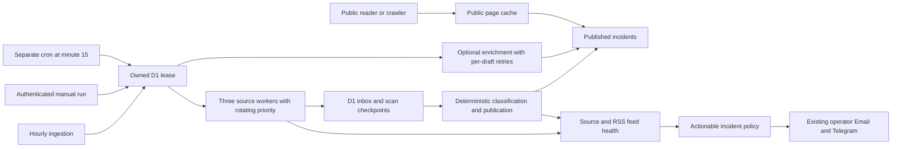

# Ingestion and public serving architecture

## Decision and evidence (2026-10-20)

A read-only production audit at 14:09 UTC found 554 published incidents, zero pending ingestion records, and 552 published records awaiting optional enrichment. The latest cron reported an RSS deadline. Among 35 operator emails since October 16, 23 mentioned timeouts, 11 mentioned only optional enrichment, and four mentioned HTTP 403 (categories overlap).

Retain D1 as the durable inbox/checkpoint store. Split optional enrichment into a separate scheduled invocation, bound source concurrency, and evaluate operational failures independently from diagnostic notes. The observed zero backlog does not justify replacing the durable inbox with new infrastructure. This change adds no dependencies, database migration, or external binding.

## Execution and recovery

- Collection runs at `0 * * * *`; optional enrichment runs at `15 * * * *`. Both respect the existing atomic 120-second lease. Manual ingestion retains its optional enrichment path.
- Production configuration gives ingestion 45 seconds, reserving up to four seconds for durable processing after collection stops. Three source workers allow at most four simultaneous source requests because NVD has two query workers. Source priority rotates durably. Workers settle before the lease is released, including on database failure.
- Validated relevant events are staged before checkpoints advance. Existing publication policies, historical recovery, editorial decisions, deduplication, request quotas, and GHSA caps remain in force.
- Network timeouts now increase exponential cooldowns, like retryable HTTP failures. Local request-budget pauses never increase outage backoff.
- RSS records independent health, success, failure streak, and cooldown per feed. A failing feed cannot block a healthy sibling or have its failures erased by sibling success. Aggregate success uses the oldest recorded feed success.
- CISA KEV can use the official `cisagov/kev-data` mirror after a primary failure if request time remains, with the same validation and budget. An exhausted deadline defers fallback until a later run.
- Enrichment has a separate 45-second invocation budget and up to 20 seconds per provider request. Failed drafts get persistent retry eligibility and attempts; lower-attempt eligible drafts proceed first. Provider failure sets a one-hour global cooldown. Publication never waits for enrichment; enrichment never refreshes the collection heartbeat.

## Health and notifications

Health returns raw `errors`, informational `warnings`, actionable `alertIssues`, source/feed diagnostics, separate enrichment state, backlog age, and history. Transient failures become actionable after three consecutive failed scans or three hours of continuous failure. Authentication/configuration errors and genuine upstream HTTP 429 remain immediately actionable. Six hours without source success, stale cron heartbeat, aged pending records, and quarantine requiring review remain actionable.

The six-hour notification interval uses source problem identities. Switching between timeout and HTTP 503 or rotating NVD keywords does not create a new outage. RSS feeds remain distinct. A new issue does not extend an existing issue's reminder deadline. Credential warnings survive later successful phases. Enrichment deferral, local quotas, and cooldown notes do not send ingestion outage emails.

An independent authenticated monitor is still necessary to detect a scheduler that stops running. No external monitor was provisioned by this change.

## Public availability

Public GET pages use a named Workers cache with one-minute freshness. On a thrown rendering error or HTTP 5xx, a successful cached response can be served for up to 24 hours with a stale warning. A cached copy is not guaranteed in every Cloudflare location. Successful rendering replaces the cached representation.

Credentials, cookies, query strings, APIs, admin routes, errors, redirects, private responses, and Set-Cookie responses bypass storage. Cache failure falls back to normal rendering. Publication changes can take about a minute through the server cache, plus client freshness. Negative responses are never cached.

## Deployment and rollback

At audit time dashboard version `a8a0b2c8-bab9-4c37-bd18-9c47ae2d9364` served 100%. Before rollout, refresh deployment metadata, reconcile dashboard variables, preserve secrets, verify the 45-second setting, and enable both cron expressions. No migration is needed.

Verify archive, an existing detail URL, robots, sitemap, redirects, unauthorized health, and authenticated health. Observe the next actual ingestion and minute-15 enrichment runs. Rollback restores the preceding Worker version and hourly trigger configuration while retaining all D1 data. Local tests cannot establish production alert-volume improvement before rollout and observation.

## References and scaling

Rollout executed at the user's request on 2026-10-20 at 14:34 UTC: version `669b6f74-f01a-447c-9e85-3d8838af311a` serves 100%, both cron expressions and the 45-second setting are confirmed, and existing secret names are retained. Public/custom-domain smoke checks pass. Next expected collection/enrichment executions are 15:00/15:15 UTC; they were not yet observed when this record was written. See the task file for detailed evidence.

- [Cloudflare connection limits](https://developers.cloudflare.com/workers/platform/limits/#simultaneous-open-connections)
- [Cron triggers](https://developers.cloudflare.com/workers/configuration/cron-triggers/)
- [Cache API and location-specific behavior](https://developers.cloudflare.com/workers/runtime-apis/cache/)
- [Official CISA KEV mirror](https://github.com/cisagov/kev-data)

If sustained backlog exceeds the bounded D1 processor, move source tasks and processing to Cloudflare Queues with independent retries/dead-letter handling, preserving stable identities and stage-before-checkpoint ordering. That is a measured scaling decision, not a prerequisite for the observed failures.

## Newsletter isolation

The work-email weekly digest uses independent D1 state, subscriber consent and an outbox through the existing Resend service. Its five-minute trigger never invokes source collection. See [newsletter operations](newsletter.md) for confirmation, schedule, retries, operator controls and rollback details.
